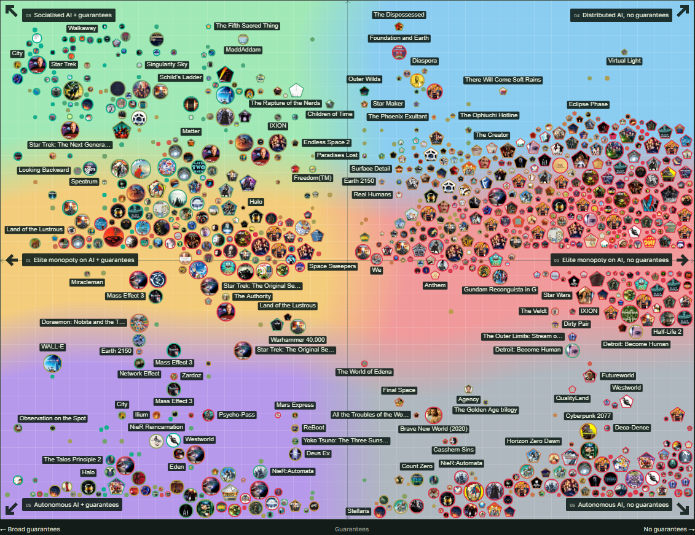

# Post-Work Theory

What happens to society when AI and robots can take over production, and a job
ceases to be the main way people obtain a livelihood?

**Post-Work Theory** explores that question through science fiction. Its
interactive map brings together **893 societies** from books, films, television,
games, anime and comics — from the Federation in *Star Trek* and the Noon
Universe to the worlds of *WALL-E*, *Manna*, *The Matrix* and *Dune*.

**[Explore the map, essay and data →](https://vadimfedenko.github.io/Post-Work-Theory/)**

## What does “post-work” mean?

Automation changes how goods are produced and how people gain access to them.
If machines provide the goods and services, what supports people whose labour
is no longer needed to earn a living?

The project examines a shift from wages to other ways of accessing resources:
shared provision, ownership of productive assets, institutional allocations,
patronage or decisions made by an autonomous system. People may continue to
do science, make art, care for others and undertake useful work. The central
question is how they obtain the means to live.

Science fiction offers many possible outcomes: abundance, dependence on the
owners of technology, new forms of inequality, and worlds where machines
themselves make the decisions.

## Two questions, six social models

The framework is built around two questions:

1. **Who controls AI and productive infrastructure?** Society, elites or an
   autonomous system?
2. **Are people's material needs guaranteed?** How secure is their access to
   resources once the familiar wage system disappears?

Together, these questions define six models:

| Who controls the technology? | With guarantees | Without reliable guarantees |
| --- | --- | --- |
| Society | **3. Socialised AI** | **4. Distributed AI** |
| Elites | **1. Elite monopoly over AI** | **2. Elite monopoly over AI** |
| Autonomous system | **5. Autonomous AI** | **6. Autonomous AI** |

Each model allows for different political arrangements and living conditions.
Material security, freedom and wellbeing are considered separately: a society
that provides for everyone can still be a dystopia.

## Reading the map

- **Horizontal position shows guarantees:** broad provision on the left,
  absent or unreliable provision on the right.
- **Vertical position shows control:** society at the top, elites in the
  middle, autonomous systems at the bottom.
- **Marker colour shows wellbeing:** from red for dystopian societies to
  green for more utopian ones.
- **Marker size reflects how recognisable the work is:** larger markers
  help you find familiar fictional worlds.
- **Marker shape shows the stage of transition:** circles represent post-work
  societies; pentagons represent work-based and transitional societies.

The map also includes worlds where a post-work transition has not happened.
They help explain why advanced technology alone does not end dependence
on employment.

## Explore familiar worlds

Hover over a marker to open a society's card, then click to keep it open.
Cards describe the economy, control over technology, material guarantees,
working participation, related societies and sources.

Filter by medium or stage of transition, explore the map, compare societies
in the table, or download a CSV. The **Fun data** section brings together
patterns across the catalogue. The accompanying essay explains the framework
and discusses examples. The interface is available in English and Russian;
the essay is currently in Russian.

A single fictional universe may appear several times: different periods,
populations and possible outcomes can form distinct societies.

## Interpreting the assessments

This is a research framework for discussing possible futures. Coordinates
and wellbeing scores are interpretive assessments, with sources and
qualifications available in each card. They are not canonical statistics or
a forecast. Working participation is assessed separately and does not, by
itself, determine whether a society is post-work.
