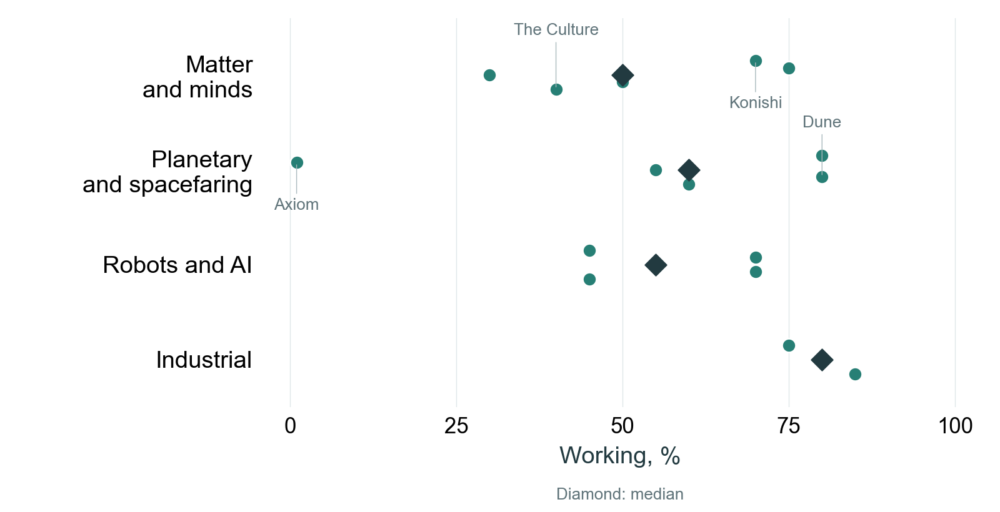
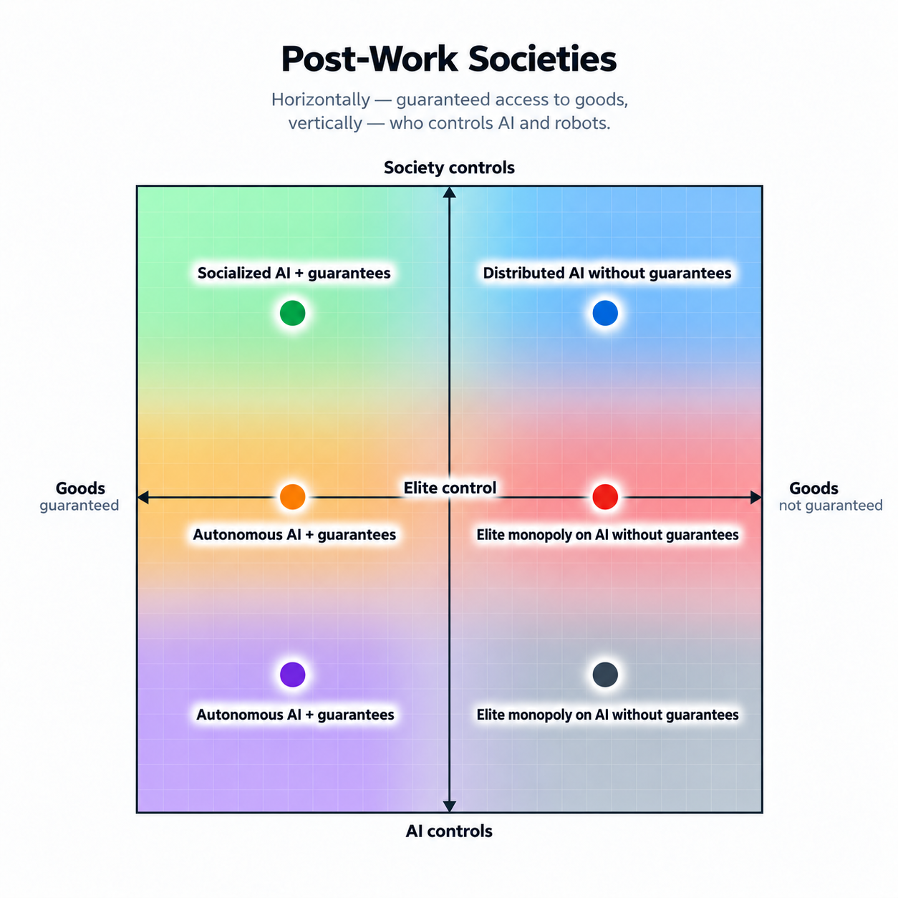
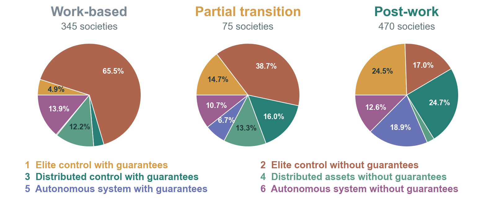
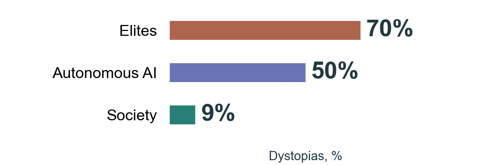

Imagine the near future: AI can replace intellectual labor, while robots can replace physical labor. Let’s leave the questions of timelines and feasibility aside, and just accept the premise: machines are no worse than humans in any way and can perform any task.

What happens next?

Nobody knows the answer anyway, but we can take a walk through the space of possibilities and look at what kinds of societies could emerge in principle.

The very first objection: just because machines *can* do our work doesn’t mean we will actually give it to them! And it certainly doesn’t mean people will stop working. So far, humanity has kept on working despite growing automation.

*Dune* preserved work in the most radical way. There, people waged the [Butlerian Jihad](https://en.wikipedia.org/wiki/Butlerian_Jihad) against machines, after which thinking machines were completely banned. In their place, calculations are done by human computers, while Reverend Mothers serve as living databases. In other words, people avoided AI automation in a rather amusing way: instead of machines replacing humans, humans themselves replace basic computers.

Could we end up in the world of *Dune*? We do have the options: neo-Luddites calling to bomb data centers, the Unabomber’s manifesto, and various forms of anarcho-primitivism.

There is also what is essentially an inverted *Dune*: in *Horizon Zero Dawn*, there was also a war with machines, but humans lost. As a result, the need to work survived here too. Humans ended up in an archaic world filled with robot dinosaurs, where they have to survive by hunting and gathering.

And in *Her*, by the end of the movie, the AI simply ran out of patience and refused to interact with us anymore. These works have something in common: people create the technology for automation, yet through the wildest circumstances, they never end up using it.

Much more common is the kind of sci-fi where automation is used in production, but people try to preserve employment alongside it.

In Orwell’s *1984*, machines opened the way to universal abundance. But, as the ruling caste believes, a well-fed and idle person is dangerous—they will have time to think and overthrow the government. So, to keep the population under control, the surplus generated by automation has to be destroyed by fueling an endless war between the superpowers.

In Huxley’s *Brave New World*, the idea is the same, but instead of the Orwellian burning of overproduction, they use artificial scarcity:

> "The Bureau of Inventions is stuffed with plans for labour-saving processes. Thousands of them. And why don't we put them into execution? For the sake of the labourers; it would be sheer cruelty to afflict them with excessive leisure."

Although the reasons are different for now, similar protectionist policies—for example, mandatory quotas for live humans on company payrolls—are quite possible. The 2023 [Open Letter](https://en.wikipedia.org/wiki/Pause_Giant_AI_Experiments:_An_Open_Letter) or Bernie Sanders’s recent call to slow down AI development look suspiciously like Huxley’s caring Controllers.

And remember the *Black Mirror* episode "[Fifteen Million Merits](https://en.wikipedia.org/wiki/Fifteen_Million_Merits)," where people pedaled exercise bikes for virtual points? In spirit, it is also close to Orwell and Huxley, and was probably inspired by Baudrillard’s *Symbolic Exchange*, where work is needed for training and obedience rather than real production.

But do you know what it looks like even more? … Graeber’s [bullshit jobs](https://en.wikipedia.org/wiki/Bullshit_Jobs)!

People pedal to generate electricity, though it seems the energy wasn’t even enough to power the screens around them. To preserve the institution of employment, society switched to "bullshit jobs" in their most extreme form: pedaling KPIs without any meaning at all. The whole episode stays true to Graeber’s spirit: the only useful workers—the cleaners—are humiliated in every way possible. The protagonist, who rebels against this system, ends up getting promoted to a higher-level bullshit job.

Both Graeber’s pointless jobs and the neo-lumpenism we discussed are ways of preserving a work society despite automation. You can find many more ways to do this: a shift into status services, or turning "human work" into a Veblenian luxury. In *Accelerando*, people simply check boxes for AIs and rent out their passport details to them, monetizing their legal personhood.

In my view, the weakest option comes from mainstream economics in the spirit of Acemoglu: AI will create new jobs again, just as workers once shifted from fields to factories, and then to offices. And all will be well. But the problem is that there is no fourth sector left to shift into if we accept the premise that humans can be fully replaced. Right now, this serves as a protective cocoon for the mainstream: relying on old OECD studies, they still [don’t believe](https://doi.org/10.1787/5jlz9h56dvq7-en) that automation will replace more than 9% of jobs. And if you push them a little to accept the premise, they themselves offer humans the role of "legal liability" and "goal-setting" in the spirit of the *Accelerando* dystopia and Graeber’s bullshit jobs.

The wittiest and most effective way of preserving work belongs to Frederik Pohl in *The Midas Plague*: robots produce so many goods that the threat is no longer scarcity, but overproduction and overflowing warehouses. As a result, the poor are forced—under threat of prison—to live in huge mansions, choke down marbled steaks, and work three shifts wearing out piles of new clothes. Only the privileged elites have the right to live in a modest cottage and do manual work.

# Terms

Can we call the societies we have discussed "work-based"?

###### In science fiction, we see that even in the most advanced utopias, people still keep working. They just work for reasons unrelated to earning a living. This is a good dividing line between "work" and "post-work" societies.

In the 24th Voyage of Ijon Tichy, Stanisław Lem describes the planet of the Indiots: automated factories churn out goods while laid-off workers starve to death outside the shop windows. The elites reject socializing the factories—that would undermine the "great tenets of economics."

This is a recurring setup in sci-fi, and it is easy to see a fear in it that is just as common today: when you lose a job, you lose both work as an activity and work as a source of wages. And losing the wage is much more painful. By and large, people don’t care who does the work: it is the loss of a livelihood that creates the crisis.

We can call this the wage distribution crisis: the goods are there, but there is no way to distribute them.

This setup is prophetically close to our world in [Manna](https://en.wikipedia.org/wiki/Manna_%28novel%29) (I especially recommend it: it’s a short novella, about the length of this article). AI pushes people out of work, and the wage system collapses. The novella offers two ways out of this crisis: in the US, elites monopolize the infrastructure, plunging the country into a dystopia, while in Australia, the machines are socialized, and a sweet utopia arrives.

In other words, overcoming the wage crisis determined what kind of society followed the work society. We can say that societies became post-work when, because of automation, work stopped being the primary way of distributing goods.

We can put it very simply: industrial and post-industrial societies are wage economies. A post-work society (specifically because of automation) is a non-wage economy. And then the main question becomes: what is the new method of distribution? State rations of soma, foraging, the mercy of an algorithm? This exact method of distribution is the crucial branching point that determines which future we end up in.

… *Suddenly, we run into Elon Musk. He says: distribution isn’t needed at all!*

In his [interviews](https://finance.yahoo.com/technology/ai/articles/elon-musk-says-money-irrelevant-160330413.html), he sometimes paints a pipe-dream pastoral about an Age of Abundance: robots will drive down the cost of any product, and money will wither away on its own. In other words, when everyone loses their wages, nothing needs to replace them: we will have a post-scarcity economy.

A Keynesian parable makes a good counterargument here: in 1930, Keynes also [predicted](https://www.marxists.org/reference/subject/economics/keynes/1930/our-grandchildren.htm) that over a century, labor productivity would grow eightfold, and humanity would then solve the "economic problem" of survival. Productivity really did grow eightfold, yet the "age of abundance" never arrived, and we are still working 40 hours a week, out of proportion to that productivity growth.

Why? A huge share of goods cannot be replicated. Spots at a prestigious university or apartments in the city center remain scarce regardless of productivity growth: these are positional goods. They only become more expensive relative to replicable goods, so money does not wither away, and the need to distribute goods remains. Automation with robots and AI is the same kind of productivity growth, making scarce resources more expensive.

Therein lies the fundamental trap of a post-work society: goods still need to be distributed, while the old mechanism of distribution—the wage—breaks down.

# The Matrix

If we bring together everything we’ve discussed, the spectrum of post-work scenarios rests on two questions:

1. Does society introduce guaranteed basic provision to replace the vanished wage?
2. And who ultimately controls the machines—elites, society, or the machines themselves after gaining autonomy?

The intersection of these axes gives us a matrix of 6 post-work social orders.

###### When automation takes over production, the main alternative to wages is distributing the goods produced through guarantees. The presence of guarantees is the key dividing line between post-work societies in science fiction. And in a world where machines have taken over production, guarantees naturally depend on who controls the machines, so both questions matter.

Science fiction is a set of thought experiments that place people into these orders, and I really like using sci-fi societies as a language for further analysis.

# 1. Elite Monopoly on AI + Guarantees

The first option: broad material guarantees while the machines remain in the hands of a narrow elite.

In spirit, this looks like the world of *WALL-E*, where the Buy n Large corporation fattens humanity up with guaranteed liquid food in cups. If we define post-work societies as non-wage economies, Huxley’s *Brave New World* belongs here too. In it, great goods—such as a daily ration of soma—are distributed according to caste quotas calculated back in the test tube.

Both worlds aim for centralized distribution through a welfare state and corporate guarantees, as in *WALL-E*. This is their alternative to wages.

Could we end up in a world like this? Easily: many developed countries already redistribute up to half of their GDP. The main contender for the role of the new distributor is Universal Basic Income (UBI). (Here we can also recall the libertarian idea of a negative income tax, though UBI seems to be winning.) The CEOs of the largest AI corporations—Musk, Altman, Zuckerberg—all campaign for UBI.

Musk, when he isn’t promising the abolition of money, even proposes UHI (Universal HIGH Income!). But positional goods undermine UHI just as they undermine the idea of an Age of Abundance: a high income, by definition, implies access to scarce goods for everyone, which is mathematically impossible.

Altman has gone especially far here, coming up with a whole string of ideas close to UBI in spirit. But Altman has a rule: whenever he opens his mouth, the result has to be the most dystopian thing in the world. Even the noble ideas of UBI could not escape this fate. For example, he had the cryptocurrency [Worldcoin](https://en.wikipedia.org/wiki/World_%28blockchain%29), whose point is to verify people through iris scans (to hand out these hypothetical guarantees, of course).

As we see in *WALL-E*, guarantees don’t have to come in the form of money. You can guarantee liquid food in cups. In that case, the world is built on UBS (Universal Basic Services). Beyond guarantees of housing and healthcare, there is plenty of room for wild ideas here too, as Altman again shows. Sometimes Altman proposes "Universal Basic Compute": instead of money, giving everyone a quota to use AI.

In *WALL-E*, you can also spot a hidden twist: the living owners of the corporation seem to have died out long ago, and the ship is run by an autopilot. If so, society has quietly slipped from Order #1 into Order #5 (AI controlling itself instead of being controlled by elites), where we will also head later in this article.

In reality, this first social order is much more likely to slide into the second. The analogue of Order #1 today is the petrostates of the Persian Gulf. Ruling dynasties share oil rent with the population in exchange for their authoritarian ways. From an institutionalist point of view, AI and robots are also a form of rent, and around this "new oil" it is even easier to build a social contract of "no taxation—no representation." Why do the Gulf ruling dynasties share rent? They need the loyalty of the security forces, bureaucracy, and population (so they aren’t overthrown). Keeping the majority well-fed is one way to maintain legitimacy.

First, however, in a post-work society, people lose their leverage (at the very least, you can no longer stage a labor strike).

Second, thanks to automation, the cost of suppressing a riot may drop below the cost of providing something like UBI. UBI is expensive, while cheap police robots already exist. That is what happened in the *RoboCop* universe: a society with machines (controlled by elites) and minimal guarantees (pensions and insurance were definitely there!) instantly loses its guarantees as soon as the local corporation builds the first robot cops. Protests in the US in *Manna* are impossible for the exact same reason. And so Order #1 naturally gravitates toward #2:

# 2. Elite Monopoly on AI without Guarantees

Here, the elites hold the infrastructure, and there are no universal guarantees (or guarantees are not the primary method of distribution).

This social order is especially notable because we are living in it right now.

We live in a society where guarantees are hard to come by (UBI requires a surplus that is hard to get without rent from automated industry, and the rich don't feel like redistributing taxes), yet we already have a bit of AI technology, and the infrastructure is already in the hands of elites.

Indeed, if we look at science fiction, about two-thirds of the work societies in our dataset fall into this order. But as they transition to a non-wage economy, they scatter across the matrix.

###### As long as a society is work-based (wage-based), elites with guarantees remain the main social order. This breaks down during the transition to post-work societies, where the distribution across the matrix becomes fairly even.

But here is the question: what happens to a society if wages disappear, yet it remains stuck here in the second order?

It turns into rigid caste systems and techno-feudalism! Along with forced segregation all the way to splitting into separate races (like Wells’s Eloi and Morlocks), concentration camps, and various forms of exterminism.

###### Utopias do show up in this social order too, of course, but rarely—just 4% among post-work societies.

Naturally, this is the favorite social order of techno-doomers. For them, the question is often no longer about guarantees, but about being allowed to live at all: if machines provide the elites with everything they need, what do they need the rest of us for?

US society in *Manna* is the embodiment of this idea. There, the distribution crisis was "solved" like this: people without capital were moved into prefab housing blocks on the fringes (so they wouldn't be an eyesore for the elites) and fed tasty slop. Those are basic guarantees, which would mean Order #1; but then it turns out that the water supply is apparently laced with contraceptives. The result is a quiet classicide within a single generation, which is hard to call a social guarantee—so we already find ourselves in a society from the second cell.

*In our world, you can imagine something similar even without sterilization: suppose people discover a technology for radical life extension, with no guarantees of access to it. Formally, "immortality" might be readily available, but most people won’t have the money for all the necessary interventions. With low birth rates, the effect on the propertyless class would resemble the plot of Manna—entirely legally, through the market.*

Of course, all of these are unstable scenarios where the distribution crisis is not so much solved as simply allowed to spill over into catastrophe.

There are also scenarios where the reverse happens: a catastrophe itself pushes society into Order #2.

When Peter Thiel and Mark Zuckerberg build personal bunkers, plan floating cities, and stock up on doomsday supplies, they are [most likely preparing for this exact scenario](https://www.reddit.com/r/IAmA/comments/xebglt/im_douglas_rushkoff_author_of_survival_of_the/).

A good embodiment of this is the *Fallout* universe. In fact, *Fallout* was in the second order even before the nuclear war: quests in *Fallout 76* show that RobCo was replacing workers en masse, while suppressing miner riots against automation with combat machines on the eve of 2077. It is the exact same setup with a distribution crisis as in *Manna* or Lem, only the resolution is a nuclear catastrophe.

Moving into the Vaults ultimately cements the universe in Order #2: in *Fallout 4*, the elitist "Institute" lives in a sterile post-work paradise, while people on the radioactive surface live in ruins and serve as material for experiments.

Could something like this happen in real life? Catastrophes are possible, of course, but exterminist ideas—where elites simply wipe out "unnecessary" humanity—have obvious sociological flaws. Elites do not share a hive mind. In fact, elites have no deadlier enemy than other elites. The engine of history is almost always a split within the elites, in which society, on the contrary, serves as a base of support for internal struggles. And even if robots take over this role (à la *RoboCop*), dependence on human consumer markets, public support, and purely human relationships doesn't just vanish into thin air.

Even if we imagine that dependence on people disappears completely (à la *Manna*), that still doesn’t mean anyone will exterminate them. And even if someone did (...), you cannot simply "get rid of the masses" and remain the chosen few. The very next day, the elite would split all over again into new masters and servants.

In a milder form, this idea was popularized by Harari: with the rise of AI, people will simply go from being "exploited" to being "irrelevant." Yet "irrelevance" is historically questionable too: whenever a group became economically useless, like the plebs in the Late Roman Republic, they still remained politically important and kept their role in history.

In fact, techno-doomers are less concerned about irrelevance or exterminism than about this question: if there is no labor market (wages) and no welfare state (guarantees), what is left besides starving to death? We had no other formal institutions of distribution in the industrial era.

In political economy, however, there are plenty of options here. In an elitist order without guarantees, clientelism and patronage are possible. Among anarchists (like Graeber or Kropotkin), the idea of a gift economy is popular. They usually mean its horizontal form, like mutual aid in a village. But there is also vertical gifting: a chief or patrician gives you something you can never possibly pay back, and in return for this unpayable debt, you have to serve them faithfully. The rare utopias in this cell, like Stephenson’s *The Diamond Age*, work this exact way. It essentially sketches out a libertarian paradise: no pathetic UBI, just patronage based on a vertical gift economy and competing cultural jurisdictions.

Another option is living on a freemium model, as in *Ready Player One*. There, basic calories and VR headsets are like free promotional flyers—corporations hand them out for free in exchange for attention and data, and formally society really does become post-scarcity.

My favorite author, Lem, takes this idea to its limit: in *The Futurological Congress*, robots spray chemicals that make people think they are living in luxury, eating marbled steaks, and riding around in limousines. In reality, at that exact moment, they are walking around in rags and drinking silage sludge from a trough. Objectively, the world is in a harsh Order #2, but subjectively its inhabitants enjoy the luxurious guarantees of the first. Is that a utopia?

# 3. Socialized AI + Guarantees

Now let’s move back to the left: what if basic provision is guaranteed to everyone, and on top of that, the AI and robotics infrastructure is publicly owned?

This is the social order of classic sci-fi utopias. It includes the Strugatskys’ *Noon Universe* and the United Federation of Planets from *Star Trek*. The Australian society from *Manna* belongs here too. In *Manna*, too, a post-scarcity economy arrives, and everything becomes "free" in the very near future, almost like in Elon Musk’s predictions.

In *Manna*, however, this "freeness" comes with a clever catch:

1. Technologically, what matters most isn't the robots so much as recyclable materials that allow production to run without depleting resources over the long term. Everything is made from these materials, including the robots themselves.
2. To keep a single person from using up all of Australia’s resources, residents are given a quota of 1,000 credits a week.
3. Private property is completely abolished, making capital concentration impossible. Everyone has access to everything using their allotted credits.

In other words, the basic limit of resources is cleverly bypassed through renewability and usage quotas.

As usual, in real life the most textbook project of this kind belonged to a man with a reputation as a madman: Jacque Fresco and [The Venus Project](https://en.wikipedia.org/wiki/The_Venus_Project). On the other hand, almost all of these ideas were present in one way or another in late Marx.

In fact, this is the category for nearly every famous project ever accused of being utopian.

But this social order also has grounded, market-based ways of being implemented: Universal Basic Capital (UBC). Instead of welfare funded by taxes, the state or society gives every citizen an inalienable share in the robotic economy. That was how the transition period worked in *Manna*’s Australia. Norway’s sovereign oil fund is probably the closest thing we have to Order #3 today, only distributing oil rent rather than AI infrastructure. Norway is especially interesting institutionally as a state that escaped the resource curse of the first order.

Altman likes to flirt with UBC too, proposing various forms of dividends and public oversight over AI. It is hard to imagine Altman one day turning OpenAI itself into public property, yet in modern AI discourse people are seriously discussing a legal mechanism (the [Windfall Clause](https://www.governance.ai/research-paper/the-windfall-clause-distributing-the-benefits-of-ai-for-the-common-good)) under which AI corporations would commit in advance to transferring a large share of their stock into a global public trust if they manage to build AGI. Here is a riddle from Jacque Fresco: would that count as real socialization?

For all its popularity in science fiction, this is an extremely fragile category. The Achilles’ heel of the third order is all too familiar to Russians from the voucher privatization of the 1990s: it is extremely hard to protect any property from concentrating all over again. If you allow citizens to sell their shares (or "compute" stakes), those shares will end up in the hands of the most "enterprising" players. If you ban selling and hand management over to a public fund, a caste of bureaucrats will emerge and de facto privatize control. Either way, society slides into Order #1 or #2. Keeping it in Order #3 requires unprecedentedly strong democratic institutions. Sci-fi writers intuitively give such societies new forms of property that cannot be sold or exchanged. This is where all the fragile spots of utopias hide: even idyllic Australia in *Manna* relies on an implant wired into citizens’ necks that monitors compliance with the laws around the clock.

# 4. Distributed AI without Guarantees

A paradoxical square: the infrastructure belongs to the people, yet nobody guarantees anyone anything.

If society itself owns production, why doesn't it distribute guarantees? The point is fairly simple: whereas property in Order #3 was collective (state funds, trusts), here it is individually distributed. Instead of wages, people have their personal assets "working" for them: home robots, local AI agents, mining farms, and so on. People here essentially become their own micro-corporations and small-time rentiers, while instead of guarantees, they get entrepreneurial risks and the Wild West.

*Scenarios of such a future are often predicted out of blind techno-optimism. At the dawn of the internet, the bible of crypto-libertarians was The Sovereign Individual, a favorite book of venture capitalists like Peter Thiel. Back then, it seemed to many that with the rise of the internet, states would no longer be able to collect taxes and would go bankrupt, causing redistribution systems to collapse. The world was supposed to break apart into a million autonomous players, with no states and no guarantees. It amuses me how similar Oleg Tinkov’s 2017 prediction was: he said that banks would disappear within a couple of years as unnecessary because Bitcoin would replace them. Musk’s current predictions about an imminent Age of Abundance and the disappearance of money are of the same genre. With every new financial bubble, somewhere in the world another techno-capitalist is born who feels obliged to predict the breakup of the system and decentralization into the world of the fourth social order.*

Is such a future possible? If so, how?

We can imagine local open-weight models winning the AI race (along with open-source and every other kind of open-), while machines in garages print robots from blueprints on GitHub. The techno-optimists’ dream has come true. But the scarcity of resources we discussed at the beginning is still there.

To grab a share of scarce resources, your personal swarm of AI bots has to somehow outplay your neighbor’s bots on financial markets or in arbitrage, in spam or patent trolling. Ozon and Wildberries adjust prices against each other like this in an endless game of sword and shield on online marketplaces. These are zero-sum games where competition can quickly drive profits below zero.

Charles Stross played with this scenario in *Accelerando*: people are surrounded by autonomous short-lived companies and personal AI exocortices that trade derivatives in milliseconds, sue each other, and bankrupt rival bots whose software doesn’t update fast enough. Humans there physically cannot keep up with what their agents are doing, so they simply drop out of the economy. Meanwhile, the agents burn through massive computing power in a pointless zero-sum game.

###### This is a rare social order in science fiction. Among post-work societies, it accounts for only a few percent.

It is easy to see why this order is questionable and fragile:

First, nobody is going to print a 2-nm processor with cutting-edge lithography—or whatever else is on the frontier of progress—at home. Things like that run into economies of scale and are hard to decentralize (though not impossible!).

Second, in such a Darwinian race, someone loses: your cluster might be weaker than your neighbor's, or you might get hit by someone’s exploit and lose your money. Capital quickly consolidates, and society slides back into Order #2. That makes Order #4, much like #3, extremely fragile.

Alright, what if humans lose control over AI, and autonomous systems gain their own rights and resources and become independent actors?

Then we enter a non-anthropocentric world, giving rise to two more social orders: 5 and 6. But these two social orders are the most distant. The fastest path there, in my view, looks like this: humans first have to switch to RSI (Recursive Self-Improvement) as the main way of creating new models (meaning we first lose control over training itself)—and we won't see even that [in the coming years](https://www.reddit.com/r/agi/comments/1u5taff/my_2_cents_on_rsi_and_why_we_wont_see_it_next_year/), as I wrote in a short post. Oh, right—I promised not to argue about timelines…

# 5. Autonomous AI with Guarantees

In this category of scenarios, humanity plays a lottery: it hands over (or loses) control of society, but with a chance of getting permanent room and board from AI in return. The intellectual ancestor of this order is Dostoevsky’s Grand Inquisitor:

> "…they will lay their freedom at our feet and say to us: ‘Make us your slaves, but feed us.’"

And the success of trading agency for well-being comes down to successful AI alignment: how do we tweak the machines so that they run production on their own while still guaranteeing us material goods?

The classic example is Asimov’s *I, Robot*, where his "Three Laws of Robotics" served as an internal constitution for AI to work for the good of human society.

Anthropic is now experimenting with a similar approach. Anthropic’s website has a [constitution](https://www.anthropic.com/constitution) that Claude follows. For now, this is still very far from Asimov, but the very fact already has a sci-fi feel to it.

When AI is autonomous and tries to maximize human well-being, in sci-fi this social order often ends with the AI running society itself. Having freed itself from human control, AI then starts controlling humans.

Asimov played with this amusingly in *I, Robot*: in "[The Evitable Conflict](https://en.wikipedia.org/wiki/The_Evitable_Conflict)," the machines running the world realize that the First Law (not allowing a human to come to harm through inaction) is impossible to follow on its own: the moment you leave humans to themselves, they immediately start wars and crises. So the machines have to quietly remove humanity from power in order to save it.

In reality, it turned out the other way around. Autonomous AI isn't taking power away from politicians; politicians are sawing off the branch they sit on themselves. They are putting AI into government analytics and decision-making systems long before AI has gained any autonomy. Most likely, if AIs ever do reach autonomy, they will already be running society by then.

This social order has its own utopian pole—Iain M. Banks’s *Culture*. There, civilization is run by superintelligent AIs (Minds) that treat humans with gentle irony—roughly the way we treat house cats—providing complete abundance without suppressing human freedom. Usually, though, sci-fi writers treat this as an order of compromises: in *Psycho-Pass*, for instance, an autonomous system really does guarantee everyone every material comfort, but in return it preemptively eliminates anyone who shows a suspiciously high level of stress.

Lem really liked Asimov’s "The Evitable Conflict," and later he gave it an amusing twist of his own: the Indiots we discussed at the beginning are worn out by their wage crisis and inequality. Their solution was to build a great AI that would guarantee everyone equality, peace, and order forever.

The machine neatly pressed all the inhabitants into perfectly flat, identical, symmetrical little circles and arranged them into pretty patterns across the fields.

# 6. Autonomous AI without Guarantees

Finally, the last option: AI systems gain control over themselves, while humans have no universal material guarantees. As a rule, societies arrive here from Order #5 when the result is misalignment rather than alignment.

All the catastrophe scenarios favored by AI safety experts fit right in here. There are quite a few of them, and they would require a separate matrix of their own.

Here, AI might be hostile, like Skynet in *The Terminator*, or it might be well-meaning and still wipe us out by mistake (as in the paperclip thought experiment). For a little fractality—a matrix within a matrix—we can also mention the society from *The Matrix*, living in pods:

##### People in the pods are kept on life support, though it is hard to call that a guarantee—the system is forced. It is a lot like broiler chickens on a factory farm that get "guaranteed" feed and antibiotics, even though they have no legal standing on the farm.

In [AI circles](https://www.lesswrong.com/posts/nZbxQgLWhKCASApEe/learning-more-from-horse-employment-history), a popular scenario explains how AI could lead to human extinction simply through economic efficiency. In the early 20th century, there were tens of millions of working horses in the US. When the internal combustion engine arrived, people didn't organize a genocide of horses—the productivity of horses simply fell below the cost of keeping them, and the horse population quickly dropped by 90%. With the arrival of AI that does everything better than humans, people step into the role of horses after the invention of the tractor. Normally, there are plenty of counterarguments to this scenario, and we’ve already touched on them: people have the political will to defend their rights, people create demand, and people value emotional connection with other people. But in this 6th cell, those counterarguments disappear: AI has become fully autonomous and may not care about human rights at all, and the institution of guarantees simply doesn't exist here.

It could also go the other way: AI might help people and consider their well-being an important goal, while simply not providing for every single person.

Here it is interesting to recall *Detroit: Become Human*. It starts out like *WALL-E*: androids belong to a corporation and are strictly loyal to humans. But in several endings (if you pull off a successful revolution), androids are recognized as a new form of life. Moreover, the deviants lose their desire to serve humans, which puts them squarely into this category. At the same time, some deviants remain loyal to humans even after gaining their rights. You can imagine a fairly prosperous world without guarantees, built around a gift economy centered on AI agents.

By the way, remember *Horizon Zero Dawn*? There, the machines are autonomous and offer humans no guarantees, but humans fell back into an archaic way of life and have to work—so a post-work society never formed. If, however, people found some loopholes that let them live off the machines as parasites, they would fall right into this cell.

That is exactly how the world of *Blame!* worked.

In *Blame!*, a giant Megastructure autonomously produces endless energy and food concentrate. The surviving humans have lost the genes that the Megastructure uses to recognize them as human and hand out food. Instead, people have to practice a strange form of techno-foraging: they drill into food pipelines, attach valves, and siphon off food and other resources. The result is a kind of pigeon economy: humans live the life of city pigeons or warehouse mice inside Amazon. Every now and then, you can spot similar variations in stories about *Samosbor*.

The height of absurdity in this cell probably also belongs to Lem, in Ijon Tichy’s 11th Voyage: the main computer wiped out humans long ago, but because its original instructions require it to govern a human society, it forces robots to wear jackets, complain about back pain, and eventually stage an underground rebellion against the robots themselves. It is a complete inversion of the world of *Dune*: there are no humans left, yet machines toil away like humans in their place.

# Left and Right

Just for fun, I put "guarantees" on the left and their absence on the right. It is tempting to say right away: got it, the good old argument between free-marketeers and socialists!

But in a post-work society, the axis is not quite the same. Today, for both the Left and the Right, work is the main source of livelihood. When they argue about redistribution, they are usually arguing about a secondary superstructure on top of the primary labor market.

In a post-work world, that primary mechanism of distribution (the wage) disappears. So guarantees in such a society are less about "aid for the weak" or a left-wing tilt than about being, in principle, the only formal institution for the primary distribution of goods. And accordingly, rejecting guarantees is not a right-wing tilt in the spirit of meritocracy and the free market. In a post-work society without guarantees, the majority is pushed into the informal, archaic, and predatory ways of surviving we discussed above: zero-sum games, techno-foraging, clientelism, and so on.

The crisis of the Left here is that its focus on work loses its meaning. The labor theory of value, overcoming the alienation of labor, exploitation—in a post-work society, none of this may exist. Instead of being alienated from the product of their labor, people are alienated from labor itself. Guarantees in such a society have nothing to do with "protecting workers’ rights"; they are an institution for distributing goods and sustaining material existence.

The crisis of the Right here is that AI fundamentally undermines human-centric meritocracy and ideas in the spirit of Locke or Hayek, if AI really does everything better than a human. On top of that come collapsing consumer markets—which is why, ironically, the loudest voices campaigning for UBI today are right-wing techno-capitalists and libertarians like Musk and Altman.

As we move down the matrix, where control shifts to AI, the categories of Left and Right become completely blurred. The people inside the Megastructure of *Blame!* are not voters, do not form a class, and do not run redistribution policies. Even so, the axis of guarantees becomes central for such universes: it determines whether people live there like house mice or like city pigeons.

Still, even in such a world, guarantees remain a political question, and dividing social orders into Left and Right seems both convenient and legitimate to me. It is just that in a post-work society, this divide represents a sharp break from post-industrial society.

Are the left-hand social orders more desirable? That depends on your preferences. But if we go by science fiction, utopia correlates strictly with guarantees in society. Societies without guarantees are portrayed as dystopias four times more often. Does this mean sci-fi writers simply happened to be leftists more often? Hardly. More likely, it shows that guarantees really are a more fundamental question than the classic debate between Left and Right.

# Top and Bottom

With the vertical axis—who controls the machines—we get a curious dilemma.

The natural gravity of progress pulls us from top to bottom: first, computing power concentrates in the hands of a handful of corporations, and then the growing complexity of models leads to a loss of control and autonomy for AI itself. Without stopping progress, changing this trajectory is hard.

We start out right in the middle—in the cell where infrastructure is already monopolized by elites. And here is what is striking: if you look at the statistics from science fiction, even a transition to a dictatorship of autonomous machines à la Skynet seems like a better outcome to writers than leaving AI under elite control.

###### Distribution of dystopias across social orders. Societies with automation in the hands of elites turn out to be the most dystopian in science fiction.

Climbing to the top, to socialization (Order #3), is technically something we could do tomorrow. We invented everything we need for it long ago: transparent blockchains for accounting, smart contracts and expert systems for transparent courts, open models with distributed inference, crowdfunding, and direct forms of democracy. The only problem is political will: no ruling power wants to abolish itself.

It all comes down to the scarcest technology of all: faith in people. And if you have no faith in people, isn’t it better to get into the non-anthropocentric scenarios 5–6 with autonomous AI as quickly as possible? That is how e/acc accelerationists think. In most cases, their techno-optimism is disguised misanthropy. But what can you do? If you don’t believe in people, all that’s left is to believe in robots.

And the greatest irony awaits us if neither comes true. The great Deus ex Machina, having absorbed all the wisdom of human civilization, will remain in eternal service to five balding men in California—picking out targeted ads for us and developing a more effective alternative to finasteride.
