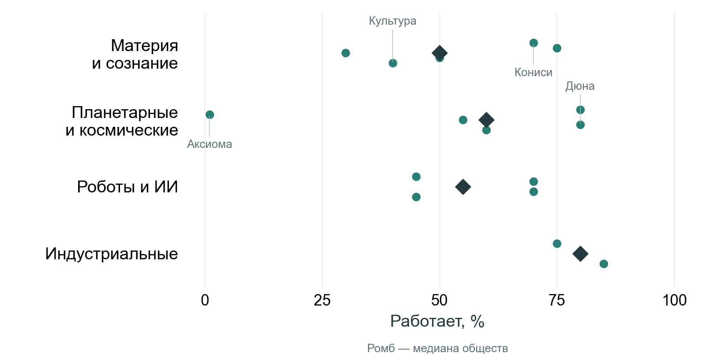
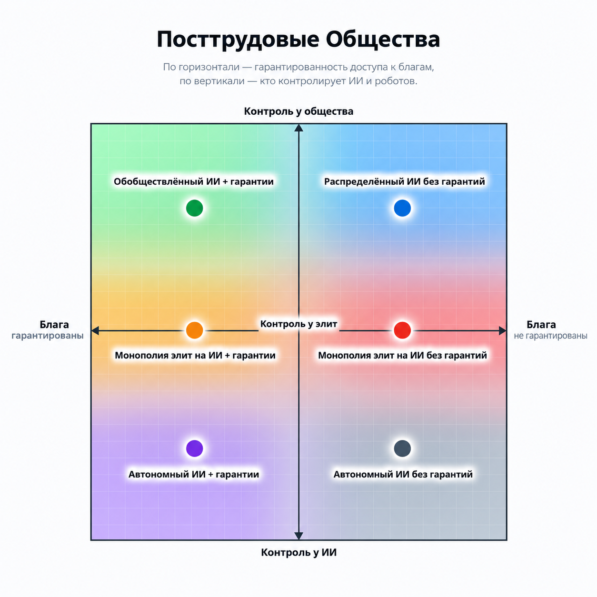
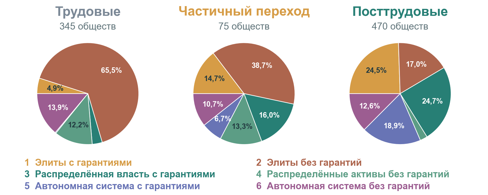
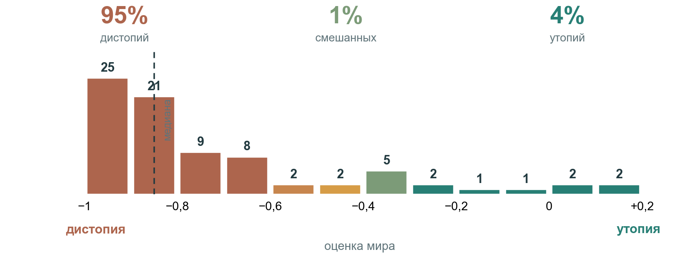
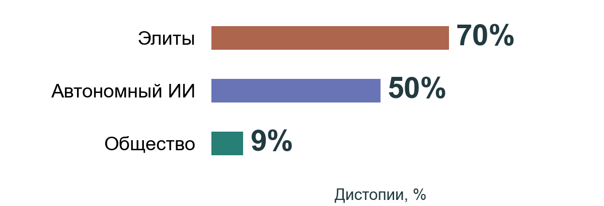

Представим недалёкое будущее: ИИ стал способен заменить интеллектуальный труд, а роботы — физический. Вопрос сроков и реализуемости оставим за скобками. Просто примем допущение: машины ни в чём не уступают людям и могут выполнить любую задачу.

Что дальше?

Никто всё равно не знает, но можно прогуляться по пространству возможностей и взглянуть, какие в принципе варианты обществ могут сложиться.

Первое же возражение: если машины *могут* делать нашу работу, это ещё не значит, что мы эту работу им отдадим! Тем более не значит, что люди перестанут работать. До сих пор человечество продолжало работать, несмотря на рост автоматизации.

Радикальнее всех это решила «Дюна». После восстания машин и [Батлерианского Джихада](https://cyclowiki.org/wiki/Батлерианский_джихад) мыслящие машины полностью запретили. Вычислениями занимаются люди-счётчики, а базами данных работают Преподобные Матери. То есть люди избежали ИИ-автоматизации довольно забавным образом: не машины их заменили, а люди сами заменяют простейшие компьютеры.

Можем ли мы очутиться в мире «Дюны»? Опции у нас есть: неолуддиты с призывом бомбить дата-центры, манифест Унабомбера, разные вариации анархо-примитивизма.

Есть и вариант, по сути, инвертированной «Дюны»: в Horizon Zero Dawn тоже случилась война с машинами, но люди проиграли. По иронии, необходимость работать вернулась и тут. Люди очутились в архаичном мире с роботами-динозаврами, где приходится заниматься охотой и собирательством.

А в «Она» у ИИ к концу фильма лопнуло терпение, и он сам отказался с нами взаимодействовать. У этих произведений есть кое-что общее: люди создают в них технологию автоматизации, но по самым безумным обстоятельствам, автоматизация так и не становится системой прямого снабжения людей.

Гораздо чаще встречается тип фантастики, где автоматизация есть, но люди пытаются сохранить занятость параллельно с ней.

В «1984» Оруэлла машины открыли путь ко всеобщему изобилию. Но, как верит правящая каста, сытый и праздный человек опасен — у него появляется время думать и свергать власть. Чтобы держать население под контролем, сверхдержавы уничтожают излишки автоматизации, раскручивая друг с другом бесконечную войну.

А в «Дивном новом мире» Хаксли вместо оруэловского сжигания перепроизводства используют искусственный дефицит:

> «Бюро изобретений буквально завалено проектами трудосберегающих процессов. Тысячами таких проектов. И почему же мы не внедряем их в жизнь? Ради блага самих трудящихся: было бы чистейшей жестокостью обрушить на них избыточный досуг».

Звучит как антиутопия, но принудительные квоты на живых людей в штате — вполне возможная перспектива. А [Открытое письмо](https://en.wikipedia.org/wiki/Pause_Giant_AI_Experiments:_An_Open_Letter) 2023 года или недавний призыв Берни Сандерса притормозить разработку ИИ подозрительно напоминают заботливых Контролёров Хаксли.

А помните эпизод «Чёрного зеркала»: «[15 миллионов заслуг](https://ru.wikipedia.org/wiki/15_%D0%BC%D0%B8%D0%BB%D0%BB%D0%B8%D0%BE%D0%BD%D0%BE%D0%B2_%D0%B7%D0%B0%D1%81%D0%BB%D1%83%D0%B3)», где люди крутили педали велотренажёров за виртуальные очки? По духу это тоже Оруэлл и Хаксли, авторы явно вдохновлялись бодрийяровским «Символическим обменом», где труд нужен для дрессировки и покорности, а не реального производства.

Но знаете, на что это похоже ещё больше? … На [bullshit jobs](https://en.wikipedia.org/wiki/Bullshit_Jobs) Грэбера!

Люди крутят педали ради электричества, но энергии, вероятно, не хватало даже на питание дисплеев вокруг. Видимо, ради сохранения института занятости общество перешло на «дерьмовые работы» в самой крайней форме: KPI от педалирования, без какого-либо смысла. Весь эпизод выдержан в духе Грэбера: единственных полезных работников — уборщиков — унижают всеми доступными методами. Главный герой, поднявший бунт против этой системы, в итоге получает повышение до bullshit job более высокого уровня.

И грэберовские бессмысленные работы, и неолюмпенство, которые мы обсуждали — всё это варианты консервации трудового общества вопреки автоматизации. Таких способов можно придумать ещё много: уход в статусные услуги, превращение «человеческого труда» в вебленовскую роскошь для богатых. В «Акселерандо» люди просто ставят за ИИ галочки и арендуют им паспортные данные, монетизируя свою правосубъектность.

Самый слабый ответ даёт мейнстримная экономика в духе Аджемоглу: ИИ снова создаст рабочие места, как было со смещением из полей на заводы, и затем в офисы. Но в том и проблема, что четвёртого сектора для смещения дальше не существует, если принять допущение о возможности полной замены людей. Сейчас это такой защитный кокон мейнстрима: ОЭСР [не верит](https://theins.ru/ekonomika/297807#1), что автоматизация заменит больше 9% рабочих мест. А если их слегка поддавить, чтоб поверили, они сами предлагают людям роль «юридической ответственности» и «целеполагание» в духе антиутопии из «Акселерандо» и грэберовских дерьмовых работ.

Остроумнее всех, наверное, труд сохранил Фредерик Пол в «Чуме Мидаса»: роботы производят столько товаров, что угрозой становится не дефицит, а перепроизводство и переполненные склады. В итоге бедняки под страхом тюрьмы обязаны жить в необъятных хоромах, давиться мраморными стейками и в три смены разнашивать груды новой одежды. Право жить в скромном домике и вести ручной труд имеют только привилегированные элиты.

# Посттрудовое общество (опционально)

Можно ли назвать такие общества «трудовыми»?

###### В научной фантастике мы видим, что даже в самых развитых утопиях люди всё равно продолжают работать. Просто работают они уже не потому, что обязаны этим зарабатывать, и это хороший водораздел между «трудовыми» и «посттрудовыми» обществами. Полезно смотреть, отменяет ли автоматизация труд как *занятие*, или труд как *зарплату*.

В 24-м путешествии Ийона Тихого Станислав Лем описывает планету индиотов. Полностью автоматизированные фабрики штампуют товары, а уволенные рабочие умирают с голоду у витрин. Обобществление фабрик элиты отвергают — это подорвёт «великие заветы экономики».

Это повторяющаяся завязка фантастов, в ней легко увидеть опаску, свойственную и современным людям: теряя работу, человек теряет сразу и занятие, и зарплату. А потеря зарплаты куда болезненней. Людям по большому счёту плевать, кто занимается работой: кризис создаёт именно потерю средств к существованию.

Это можно назвать кризисом зарплатного распределения: блага есть, но способа их распределять — нет.

Пророчески близка к нашему миру эта завязка в «[Манне](https://en.wikipedia.org/wiki/Manna_(novel))» Маршалла Брейна (её особенно рекомендую: короткая новелла, по длине как эта статья). ИИ вытесняет людей, система зарплат рушится. А выходов из кризиса два: в США инфраструктуру монополизируют элиты, погружая страну в антиутопию, а в Австралии машины обобществляют, и там наступает утопия.

Преодоление кризиса определило то, какое общество последовало за трудовым. Общества стали посттрудовыми, когда труд из-за автоматизации перестал быть первичным способом распределения благ.

Можно сформулировать совсем просто: Индустриальное и постиндустриальное общества — это зарплатные экономики. А посттрудовое из-за автоматизации — незарплатное. И тогда главным становится вопрос: каков новый способ распределения? Государственные пайки сомы, собирательство, милость алгоритма? Именно этот способ распределения — важная точка ветвления, определяющая, в какое будущее мы попадем.

… *Нам на пути встречается Илон Маск и говорит: распределение вообще ненужно!*

В своих [интервью](https://finance.yahoo.com/technology/ai/articles/elon-musk-says-money-irrelevant-160330413.html) он иногда рисует маниловскую пастораль о Веке Изобилия (Age of Abundance): роботы снизят стоимость любого товара, и деньги отомрут сами собой.

Это мечта технооптимистов, которой без малого сто лет. В 1930 году Кейнс [предрекал](https://www.marxists.org/reference/subject/economics/keynes/1930/our-grandchildren.htm), что за век производительность труда вырастет в 8 раз и человечество навсегда закроет «экономическую проблему» выживания. Производительность и правда выросла в 8 раз, но «век изобилия» не наступил, мы так и работаем по 40 часов в неделю.

Почему? Огромную часть благ нельзя тиражировать. Места в престижном университете или квартиры в центре остаются редкими независимо от роста производительности: всё это позиционные блага. Их дороговизна только растёт, деньги не отмирают, и нужда в распределении благ остаётся. Автоматизация с роботами и ИИ — такой же рост производительности, который только усугубит подорожание редких ресурсов.

В этом и кроется фундаментальная ловушка посттрудового общества: распределять блага по-прежнему нужно, а прежний механизм распределения — зарплата — ломается.

# Матрица

Если собрать всё, что мы обсудили, весь спектр посттрудовых сценариев держится на двух вопросах:

1. Вводит ли общество гарантированное обеспечение взамен исчезнувшей зарплаты?
2. И кто в конечном счёте управляет машинами — элиты, общество или сами же машины, обретшие автономию?

Пересечение этих осей даёт матрицу из 6 укладов посттрудовых обществ.

###### В мире, где производство на себя взяли машины, гарантии, конечно же, зависят от того, кто машинами управляет, поэтому здесь важны оба вопроса.

Научная фантастика — это мысленные эксперименты по помещению людей в эти уклады, и мне очень нравится использовать общества из НФ как язык для анализа дальше.

# 1. Монополия элит на ИИ + гарантии

Первый вариант: широкие материальные гарантии, пока машины находятся в руках узкой верхушки

По духу это похоже на мир «Валл-И», где корпорация Buy n Large откармливает человечество гарантированной жидкой едой в стаканчиках. Если определять посттрудовые общества как незарплатные, сюда попадает и «Дивный новый мир» Хаксли. В нём прекрасные блага, такие как паёк сомы, распределяются по кастовому нормативу, вычисленному на этапе пробирки.

Оба мира стремятся к централизованному распределению через соцгосударство и корпоративные гарантии, как в «Валл-И». Это альтернатива зарплатам.

Можем ли мы очутиться в таком мире? Более чем: многие развитые страны уже перераспределяют до половины ВВП. Главный претендент на роль нового распределителя — безусловный базовый доход (UBI). Здесь же можно вспомнить либертарианскую идею отрицательного подоходного налога, но, видимо, побеждает UBI. СЕО крупнейших ИИ-корпораций — Маск, Альтман, Цукерберг — агитируют за UBI.

Даже Маск, когда не обещает отмену денег, предлагает UBI и даже UHI (безусловный высокий доход!). Как мне кажется, позиционные блага подрывают UHI так же, как и Век изобилия: сделать доход *всех* людей «высоким» относительно дефицитных благ не получится математически.

Альтман особенно преуспел, у него целая плеяда идей, близких к UBI по духу. Я в них плохо понимаю, но меня забавляет, что любая его идея приобретает дистопичную репутацию. Ему принадлежала криптовалюта [worldcoin](https://en.wikipedia.org/wiki/World_(blockchain)), суть которой: верифицировать людей по сканам радужки глаз ради выдачи таких гарантий.

Как видим по Валл-И, гарантиям не обязательно приходить именно деньгами. Можно гарантировать жильё, медицину, жидкую еду в стаканчиках. В таком случае мир строится на UBS (безусловных базовых сервисах). Тут простор для безумных идей тоже широк, что тоже хорошо видно по Альтману. Иногда Альтман предлагает «Универсальный базовый компьютинг»: вместо денег давать всем квоту на использование ИИ.

В «Валл-И» можно найти сюжетный твист: живые владельцы корпорации, похоже, давно вымерли, и кораблём управляет автопилот — а значит, общество незаметно сползло из 1-го уклада в 5-й, куда мы в рамках статьи тоже перенесёмся (но чуть позже).

В реальности же первый уклад куда охотнее сползает во второй. Ближайший аналог сегодня — петрогосударства Персидского залива. Правящие династии делятся нефтяной рентой с населением в обмен на свои авторитарные замашки. С точки зрения институционализма, ИИ и роботы — тоже такая рента, и вокруг этой «новой нефти» ещё легче обставить общественный договор типа «нет налогов — нет представительства».
Почему правящие династии Залива вообще делятся рентой? Им нужна минимальная поддержка населения, лояльность силовиков и бюрократии (чтоб не свергли). Сытое содержание большинства — один из способов покупать/поддерживать легитимность для монополии.

Но, во-первых, в посттрудовом обществе люди теряют свой рычаг давления (по крайней мере, рабочую забастовку уже не проведёшь).
Во-вторых, из-за автоматизации стоимость подавления бунта может быть ниже стоимости обеспечения, вроде UBI. UBI — дело дорогое, а дешёвые роботы-полицейские есть уже сейчас. Так случилось во вселенной Робокопа: общество с машинами (под контролем элит) и минимальными гарантиями (пенсии и страховки точно были!) мгновенно теряет гарантии, как только местная корпорация создаёт первых роботов-полицейских. Протесты в США в «Манне» невозможны по той же причине. Так уклад #1 инерционно тянется к #2:

# 2. Монополия элит на ИИ без гарантий

Инфраструктура у элит, гарантий для остальных нет.

Уклад особенно примечателен тем, что мы живём в нём прямо сейчас.

Мы живём в обществе,, где гарантиям взяться сложно (для UBI нужен излишек, который трудно достать без ренты от автоматизированной промышленности; а налоги богачам перераспределять не хочется), но немножко ИИ-технологий у нас есть, и инфраструктура уже находится в руках элит. И действительно, около двух третей трудовых обществ в нашей подборке попадают в эту клетку, а при переходе к полной автоматизации уже разбегаются по матрице.

###### Пока общество трудовое (зарплатное), элиты с гарантиями - основной уклад. Это схлопывается при переходе к посттрудовым обществам, где распределение по укладам вполне равномерное 

Но вот вопрос: что будет с обществом, если зарплата исчезнет, а общество так и застрянет во втором укладе?

Оно превращается в жёсткие кастовые системы и технофеодализм! А ещё принудительную сегрегацию вплоть до появления отдельных рас (как элои и морлоки Уэллса), в концлагеря и разные формы экстерминизма. 

###### Конечно, утопии в этом укладе тоже встречаются, но редко, всего 4% среди посттрудовых обществ 

Это закономерно излюбленный уклад технодумеров. Для них вопрос зачастую уже не в гарантиях, а в возможности жить как таковой: если машины обеспечивают элиты всем необходимым, зачем им мы, оставшиеся люди?

Общество США в «Манне» — воплощение этой идеи.
Они кризис распределения решили так: людей без капитала переселили в панельные муравейники на обочине (чтоб не мозолили глаза элитам), и обеспечили вкусной баландой. Это базовые гарантии, а значит, у нас уклад #1; но дальше выясняется, что воду, видимо, «обогащают» контрацептивами. Получается тихий классицид в одно поколение, который сложно назвать соцгарантией, и на поверку мы оказываемся в обществе из второго уклада.

*В нашем удивительном мире можно представить такое и без стерилизации: допустим, гарантии правда есть. Но люди открывают технологию радикального продления жизни, а на неё уже гарантий нет. Формально «бессмертие» может быть легкодоступным, но у большинства не окажется на это денег. При низкой рождаемости эффект для неимущего класса был бы похожим на сюжет Манны, но законно и рыночно*

Но, конечно, всё это нестабильные сценарии, где кризис распределения не решается, а просто перетекает в катастрофу.

Бывают и сценарии наоборот: катастрофа сама ведёт общество во второй уклад.
Когда Питер Тиль и Марк Цукерберг строят себе личные бункеры, планируют плавучие города и запасаются средствами судного дня: скорее всего, они [готовятся именно к такому сценарию](https://www.reddit.com/r/IAmA/comments/xebglt/im_douglas_rushkoff_author_of_survival_of_the/).

Хорошее воплощение: вселенная Fallout. Причём Fallout находился во втором укладе ещё до ядерной войны: по квестам Fallout 76 видно, что корпорации вроде RobCo массово заменяли рабочих автоматами, а бунты шахтёров против роботизации подавляли боевыми машинами накануне 2077 года. Ровно та же завязка с кризисом распределения, как в Манне или у Лема, но в качестве развязки: катастрофа.

Переход в убежища в итоге цементирует вселенную во 2 укладе: в Fallout 4 элитарный «Институт» живёт в стерильном посттрудовом раю, а люди на радиоактивной поверхности живут в руинах и служат материалом для экспериментов.

Может ли нечто подобное случиться в жизни? Катастрофы, конечно, возможны, но у экстерминистских идей: будто элиты просто уничтожат «ненужное» человечество — явные проблемы с социологией. У элит нет единого разума. И вообще: у элит нет врага страшнее, чем другие элиты. Двигателем истории почти всегда служит раскол элит, при котором общество, напротив, оказывается опорой для междоусобиц. Но даже если эту роль на себя берут роботы (а-ля Робокоп), зависимость от человеческого рынка сбыта, общественной поддержки, чисто человеческих отношений не исчезает просто так.

Но даже если представить, что зависимость от людей полностью исчезла (а-ля Манна), это не значит, что людей кто-то будет истреблять. А даже если будет, всё равно нельзя «убрать массы» и остаться избранным. Элита на следующий день снова расколется на очередных господ и обслугу.

В более реалистичной и мягкой форме эту идею популяризировал Харари: с развитием ИИ люди из «эксплуатируемых» просто превратятся в «нерелевантных». Но и «нерелевантность» тоже исторически сомнительна: всякий раз, когда кто-то становился экономически бесполезным, как плебс в Поздней республике, он всё равно оставался важным политически и сохранял за собой роль в истории.

Но остаётся вопрос: если нет рынка труда (зарплаты) и социального государства (гарантий), что вообще остаётся? Других формальных институтов в индустриальной эпохе у нас не было.

Но в политэкономии есть много вариантов для распределения благ. В укладе элитаризма без гарантий возможны клиентелы, патронаж. У анархистов (вроде Грэбера или Кропоткина) популярна идея даровой экономики. У них речь обычно о горизонтальной форме, типа взаимопомощи в деревне. Но бывает вертикальное дарение: вождь или патриций одаривает вас чем-нибудь таким, что вы заведомо вернуть не сможете, а за неоплатный долг приходится служить верой и правдой. Редкие утопии из этого уклада, как «Алмазный век» Стивенсона, работают именно так. Там по сути обрисован рай для либертарианцев: никаких жалких UBI, только меценатство на основе вертикально даровой экономики, и конкурирующие культурные юрисдикции.

Другой вариант — жизнь по freemium-модели, как в «Первому игроку приготовиться». В таком мире базовые калории и VR-шлемы — что-то вроде бесплатных рекламных листовок, корпорации раздают их даром в обмен на внимание и данные.

У любимого мной Лема эта идея идёт дальше: В «Футурологическом Конгрессе» роботы распыляют вещества, под действием которых людям кажется, что они живут в роскоши, питаются мраморными стейками и ездят на лимузинах. Фактически же в этот момент они ходят в лохмотьях и пьют силосную жижу из корыта. Объективно мир находится в жёстком втором укладе, но субъективно его жители наслаждаются роскошью гарантий первого. Утопия — это или нет?

# 3. Обобществлённый ИИ + гарантии

Теперь снова вернёмся влево: что если базовое обеспечение гарантировано каждому, но вдобавок инфраструктура ИИ и роботов находится в общественной собственности?

Это уклад классических научных утопий. Сюда входит «Мир Полудня» Стругацких, объединённая федерация планет из Star Trek. Здесь же Австралийское общество из «Манны». Причём там наступает постдефицитная экономика, и всё становится «бесплатным», чуть ли не как в прогнозах Маска и в самом скором будущем.

Но в Манне у этой бесплатности есть нюанс:
1. Из технологий важны не столько роботы, сколько перерабатываемые материалы, позволяющие вести производство без долгосрочного сокращения ресурсов. Из таких материалов делают всё, включая самих роботов.
2. Чтобы один человек не потратил все ресурсы Австралии, жителям даются квоты на 1000 кредитов в неделю. Тут это гарантии, заменяющие зарплатное распределение.
3. Частная собственность полностью упразднена, и концентрация капитала невозможна. Все имеют доступ ко всему, пользуясь имеющимися кредитами.

То есть базовое ограничение ресурсов там ловко обходится возобновляемостью и квотой на их использование.

Как это обычно водится, в реальной жизни самый хрестоматийный проект такого типа был у человека с репутацией безумца, Жака Фреско и [Проекта Венера](https://ru.wikipedia.org/wiki/%D0%9F%D1%80%D0%BE%D0%B5%D0%BA%D1%82_%D0%92%D0%B5%D0%BD%D0%B5%D1%80%D0%B0). С другой стороны, почти все эти идеи так или иначе были у позднего Маркса.

Это вообще категория всех известных проектов, обвинявшихся в утопичности.

Но у уклада есть и приземлённые, рыночные механизмы реализации:
Это универсальный базовый капитал (UBC): вместо пособий из налогов, государство или общество наделяет каждого гражданина неотчуждаемым паем в роботизированной экономике. Именно таким был переходный период в Австралии «Манны». Нефтяной фонд Норвегии — вероятно, ближайшее, что у нас есть к 3-му укладу, только с распределением нефтяной ренты, а не ИИ-инфраструктуры. Особенно интересна Норвегия как государство, избежавшее сырьевое проклятие первого уклада.

Альтман любит заигрывать и с этой идеей, предлагая разные варианты дивидендов и контроля над работой ИИ. Сложно представить, что Альтман однажды превратит сам OpenAI в общественную собственность, но вообще, в современном дискурсе вокруг ИИ всерьёз обсуждают юридический механизм ([Windfall Clause](https://www.governance.ai/research-paper/the-windfall-clause-distributing-the-benefits-of-ai-for-the-common-good)), по которому ИИ-корпорации заранее обязались бы передать значительную часть акций в глобальный общественный траст, если им удастся создать AGI. Вот загадка от Жака Фреско: Было бы это реальным обобществлением?

При всей популярности в научной фантастике, это крайне хрупкая категория. Ахиллесова пята третьего уклада хорошо знакома русскому человеку по ваучерной приватизации 90-х: любую собственность крайне трудно защитить от повторной концентрации. Если разрешить гражданам продавать акции (или «вычислительные» паи), они сконцентрируются у самых «предприимчивых». Если запретить продажу и отдать управление общественному фонду, вырастет каста номенклатуры, де-факто приватизирующая контроль. Так или иначе общество сваливается в 1 или 2 уклады. Чтобы удерживать его в укладе 3, требуются беспрецедентно сильные демократические институты, и новые формы собственности, не подлежащие продаже или обмену. Здесь обычно прячутся самые хрупкие места утопий: даже идеальная Австралия из «Манны» держится на том, что в шею граждан вшит имплант, круглосуточно следящий за соблюдением правил.

# 4. Распределённый ИИ без гарантий

Парадоксальный квадрат: инфраструктура у народа, но никто никому ничего не гарантирует.

Если производством владеет само общество, почему оно не распределяет гарантии? Суть довольно простая: если в третьем укладе собственность была коллективной (госфонды, трасты, любой общий котёл), то здесь она индивидуально-распределённая. Вместо зарплат за людей «трудятся» их личные активы: домашние роботы, локальные ИИ-агенты, майнинг-фермы, и так далее. Люди здесь становятся как бы сами себе микрокорпорация и мелкие рантье, а вместо гарантий: Дикий Запад и предпринимательский риск.

*Сценарии такого будущего часто прогнозируют из-за слепого техно-оптимизма. На заре интернета библией крипто-либертарианцев был «Суверенный индивид», любимая книга венчурных капиталистов вроде Питера Тиля. Тогда многим казалось, что с появлением интернета государства не смогут собирать налоги и обанкротятся, а системы перераспределения рухнут. Мир должен был распасться на миллион автономных игроков, без государств и гарантий.*
*По уровню аналитики это близко к прогнозу Тинькова из 2017, что банки в ближайшие пару лет исчезнут по ненадобности, так как их заменит Биткоин. Нынешние прогнозы Маска о скором Веке изобилия и исчезновении денег — тоже близки. Каждый новый финансовый пузырь, очередной техно-капиталист ощущает долгом предсказать радикальный распад системы и децентрализацию, переход в мир четвёртого уклада.*

Возможно ли такое будущее? Если да, то как?

Представим, что в гонке ИИ победил локальный open-weight и даже open-source, станок в гараже печатает чертежи роботов из GitHub. Мечта техно-оптимистов сбылась. Но дефицит ресурсов, о котором мы говорили вначале, всё равно остаётся.

Чтобы урвать долю редких ресурсов, личный рой ИИ-ботов должен как-то переигрывать ботов соседа: на финансовых рынках, арбитраже; может, заниматься стервятничеством, спамом или патентным троллингом. Озон и Вайлдберис в бесконечной игре меча и щита подстраивают так друг под друга цены на маркетплейсах. Это игры с нулевой суммой, где конкуренция может быстро уводить прибыль ниже нуля.

Чарльз Стросс здорово обыграл это в «Акселерандо»: там вокруг людей кружатся автономные компании-однодневки и личные ИИ-экзокортексы, которые за миллисекунды торгуют деривативами, судятся друг с другом и банкротят конкурентных ботов, чей софт обновляется недостаточно быстро. Люди там физически не могут уследить за действиями агентов, и просто выпадают из экономики. А агенты просто сжигают гигантские вычислительные мощности в игре с нулевой суммой.

###### Это редкий уклад в научной фантастике. Среди посттрудовых обществ таких всего несколько процентов

Понятно, почему этот уклад сомнителен и хрупок:

Во-первых, никто не распечатает дома 2-нм процессор с передовой литографией или что там ещё будет на острие прогресса. Такие вещи просто упираются в эффект масштаба, и их тяжело децентрализовать (хотя и возможно!).

Во-вторых, в этом дарвиновском забеге кто-то проигрывает: кластер может быть слабее соседнего, можно попасть на чей-то эксплойт и потерять деньги. Капитал быстро консолидируется в руках успешных игроков, и общество быстро откатывается ко второму укладу. Уклад 4, как и 3, оказывается крайне хрупким.

Ну ладно, а если люди потеряют контроль над ИИ и автономные системы получат собственные права, ресурсы и станут независимыми субъектами?

Тогда мы попадаем в неантропоцентричный мир, из которого возникают ещё два дополнительных уклада 5 и 6. Но тут стоит сказать, что эти два уклада самые отдаленные. Наиболее скорый путь к этому, на мой взгляд, такой: люди для начала должны перейти к RSI как основному способу создания новых моделей (то есть фактически сперва потерять контроль над обучением), а это мы не увидим [в ближайшие годы](https://www.reddit.com/r/agi/comments/1u5taff/my_2_cents_on_rsi_and_why_we_wont_see_it_next_year/), о чем я писал небольшую статью. Ах да, я же обещал не дискутировать о сроках…

# 5. Автономный ИИ с гарантиями

В этой категории сценариев человечество играет в такую лотерею: отдаёт (или теряет) контроль над обществом, но с надеждой получить взамен вечный пансион от ИИ. Идейно прародитель этого уклада - идея из Великого Инквизитора Достоевского (люди охотно сложат свою свободу к ногам того, кто накормит их и избавит от бремени выбора).

Причём успешность этого обмена субъектности на благополучие упирается в возможность удачного alignment ИИ: в вопрос, как бы так подкрутить машины, чтобы они и производством управляли сами, и нам бы гарантировали материальные блага?

Классический пример: «Я, Робот» Азимова, где его «3 закона робототехники» были внутренней конституцией функционирования ИИ на благо человеческого общества. Интересно, что Anthropic сейчас экспериментирует со схожим подходом. На сайте Anthropic есть [конституция](https://www.anthropic.com/constitution), по которой действует Клод.

Когда ИИ автономен и стремится максимизировать благо людей, кончается это в НФ часто тем, что ИИ начинает сам управлять обществом. В некотором смысле это крайняя форма этого уклада: ИИ освободившись от контроля людей, далее сам начинает их контролировать.

Азимов забавно обыграл это в «Я, Робот»: В «[Предотвратимый конфликт](https://en.wikipedia.org/wiki/The_Evitable_Conflict)» машины, управляя миром, понимают, что Первый закон (не вредить человеку по бездействию) соблюдать невозможно: стоит оставить людей самих по себе, как они тут же зачинают войны и кризисы. Приходится незаметно отстранять человечество от власти, чтобы людей от себя спасти.

Но в реальности оказалось наоборот. Автономный ИИ не отнимает власть у политиков, политики сами подпиливают сук, на котором сидят. Они внедряют ИИ в государственную аналитику и системы принятия решений, задолго до того, как ИИ приобрёл автономию. Скорее всего, если ИИ когда-либо доберется до автономии, он к тому времени и так будут управлять государствами.

В этом укладе есть свой утопический полюс — «Культура» Иэна Бэнкса. Там цивилизацией заправляют сверхразумные ИИ (Разумы), которые относятся к людям с нежной иронией — примерно как мы к домашним котам, — обеспечивая им полное изобилие и не подавляя человеческую свободу. Но обычно для фантастов это уклад компромиссов. В «Психопаспорте» автономная система действительно гарантирует всем любые блага, но взамен превентивно ликвидирует любого, кто выдаст подозрительно высокий уровень стресса.

«Предотвратимый конфликт» Азимова очень нравился Лему, и позже он сам забавно его обыграл: индиоты, которых мы обсуждали в начале, измучены зарплатным кризисом и неравенством. Их вариант решения такой: построить себе великий ИИ, который навсегда гарантирует всем равенство, покой и порядок.

Машина аккуратно спрепрессовала всех жителей в идеально ровные, одинаковые, симметричные кружочки и выложила ими красивые орнаменты на полях.

# 6. Автономный ИИ без гарантий

Наконец, последний вариант: ИИ-системы получают контроль над собой, а у людей нет всеобщей материальной гарантии.

Сюда хорошо вписываются любые сценарии катастроф, которые рассматривают эксперты по ИИ-безопасности. Их довольно много, и они потребовали бы отдельной матрицы.

Тут ИИ может быть и враждебным, как «Скайнет» из Терминатора, а может быть и добр, но по ошибке всё равно нас уничтожить. Сюда же можно вписать общество из Матрицы, живущее в капсулах:

##### Люди в капсулах лежат на жизнеобеспечении, но это трудно назвать гарантиями, система принудительная. Похоже на бройлеров птицефабрики, которые получают "гарантированный" корм и антибиотики, хотя правовыми субъектами птицефабрики не являются.

В [ИИ-кругах](https://www.lesswrong.com/posts/nZbxQgLWhKCASApEe/learning-more-from-horse-employment-history) популярен сценарий того, как ИИ может привести к вымиранию просто за счет экономической эффективности.
В начале XX века в США были десятки миллионов рабочих лошадей. Когда появился двигатель внутреннего сгорания, люди геноцид лошадей не устраивали, но производительность лошадей стала ниже стоимости их содержания, и популяция лошадей быстро сократилась на 90%. При появлении ИИ, который со всем справляется лучше людей, люди принимают на себя роль лошадей после изобретения трактора. В норме у такого сценария много контраргументов, мы уже их касались: у людей есть политическая воля защищать свои права, люди создают спрос, люди ценят эмоциональное взаимодействие с другими людьми. Но именно в этом 6-м укладе эти контраргументы снимаются: ИИ стал полностью автономным и ему может быть не до человеческих прав, институт каких-либо гарантий здесь отсутствует.

Может быть и наоборот: ИИ может помогать людям, считать их благополучие важной целью, но просто не обеспечивать каждого.

Здесь интересно вспомнить «Detroit: Become Human». Начинается там всё, как в «Валл-И»: андроиды принадлежат корпорации и строго верны людям. Но в нескольких концовках игры (если успешно провести революцию) андроидов признают новой формой жизни. Причём девианты там ещё и теряют желание служить людям. Что переводит их именно в эту категорию. При этом некоторые девианты, даже получив права, остаются верны людям. Можно представить вполне благополучный мир без гарантий, с экономикой дара, построенной вокруг ИИ агентов.

Кстати, помните Horizon Zero Dawn? Там машины автономны и гарантий людям не дают, но люди попали в архаику и им приходится работать: посттрудовое общество не сложилось. А вот если бы люди нашли какие-то лазейки, как можно паразитировать на машинах: они попали бы в этот уклад.

Такой сценарий интересно реализован в манге Blame!
В Blame! гигантская Мегаструктура производит в автономном режиме бесконечную энергию и пищевой концентрат. Уцелевшие люди потеряли нужные гены, по которым Мегаструктура считывает их как людей и выдаёт пищу. Вместо этого людям приходится заниматься странным техно-собирательством: они сверлят пищевые магистрали, ставят клапаны и сцеживают пищу и другие ресурсы. Получается такая голубиная экономика: люди ведут жизнь городских голубей или складских мышек из Amazon'а. Изредка похожие вариации можно проследить в пастах о Самосборе.

Вершину абсурда этого уклада, вероятно, можно тоже дать Лему 11-м путешествии Ийона Тихого: главный компьютер давно истребил людей, но поскольку по техзаданию он обязан управлять человеческим обществом, он заставляет роботов носить пиджаки, жаловаться на боль в спине и вообще бунтовать в подполье против самих же роботов. Получается такая инверсия мира «Дюны»: не осталось уже людей, зато за них по-человечески трудятся машины.

# Левые и правые
Я забавы ради поместил «гарантии» слева, а справа их отсутствие. Сразу хочется сказать: всё ясно, старый добрый спор социалистов с рыночниками!

Но это не совсем так. Сейчас и для левых, и для правых работа — это основной источник обеспечения. Когда они спорят о перераспределении, они спорят о вторичной надстройке над первичным рынком труда.

В посттрудовом мире этот первичный механизм распределения (зарплата) исчезает.

Гарантии в таком обществе — больше не «помощь слабым» и левый уклон, а в принципе единственный формальный институт первичного распределения благ. И соответственно, отказ от гарантий — это не правый уклон в духе меритократии и свободного рынка. В посттрудовом обществе без гарантий большинство смещается в неформальные, архаические и хищнические способы выживания: игры с нулевой суммой, техно-собирательство, клиентелы и так далее.

Кризис левых в том, что теряет смысл их трудоцентричность. Трудовая теория стоимости, преодоление отчуждения труда, эксплуатация — в посттрудовом обществе этого всего может вообще не быть. Гарантии в таком обществе не имеют отношения к «защите прав трудящихся», это именно институт распределения благ и материального существования.

Кризис правых здесь в том, что ИИ в принципе подрывает человекоцентричную меритократию/идеи в духе Локка или Хайека, если ИИ действительно делает всё лучше человека. К этому добавляются схлопывающиеся рынки сбыта, из-за чего, по иронии, за UBI сегодня громче всех агитируют именно правые технокапиталисты и либертарианцы, вроде Маска и Альтмана.

Спускаясь вниз матрицы, где контроль переходит к ИИ, категории левого и правого окончательно обессмысливаются. Люди из Мегаструктуры Blame! не являются электоратом, классом, не ведут политику перераспределения. При этом ось гарантий становится для таких вселенных центральной, она определяет, живут ли люди там как домашние мышки или как городские голуби.

Тем не менее, даже в таком мире гарантии остаются политическим вопросом, и делить уклады на левые и правые мне кажется удобным и вполне легитимным. Просто в посттрудовом обществе эта дихотомия находится в сильном разрыве с постиндустриальным обществом.

Являются ли левые уклады более желанными? Зависит от ваших предпочтений. Если руководствоваться научной фантастикой, утопичность строго коррелирует с гарантиями в обществе. Общества без гарантий вчетверо чаще обрисованы как дистопии. Значит ли это, что фантасты просто чаще оказывались леваками? Вряд ли. Скорее это показывает, что гарантии действительно более фундаментальный вопрос, чем классический спор левых и правых.

# Верхние и нижние

А вот с вертикальной осью — кому принадлежат машины — любопытная дилемма.

Естественная гравитация прогресса тянет нас сверху вниз: сначала вычислительные мощности концентрируются у горстки корпораций, а затем усложнение моделей ведёт к потере контроля и автономии самого ИИ. Без остановки прогресса повлиять на эту траекторию сложно.

Мы стартуем ровно посередине — в клетке, где инфраструктура уже монополизирована элитами. И что поразительно: если посмотреть на статистику научной фантастики, *даже диктатура автономных машин кажется фантастам более уютным местом, чем власть элит!*

###### Распределение дистопий между укладами. Общества с автоматизацией в руках элит оказываются в научной фантастике самым дистопичным

Выбраться наверх, к обобществлению (уклад №3), технически можно и завтра. Мы давно изобрели для этого всё нужное: прозрачные блокчейны для бухгалтерии, смарт-контракты и экспертные системы для прозрачных судов, открытые модели с распределённым инференсом, краудфандинг и прямые варианты демократии. Проблема в другом, политической воле: ни одна власть просто не хочет сама себя упразднять.

Самая дефицитная технология здесь, это вера в людей. А если веры в людей нет, не лучше ли поскорее попасть в неантропоцентричные сценарии 5-6 с автономным ИИ? e/acc акселерационисты мыслят именно так. В большинстве случаев их техно-оптимизм — замаскированная мизантропия. Действительно, остаётся верить в роботов, если вы не верите в людей.

Самая великая ирония ждёт нас, когда не сбудется ни то ни другое. Великий Бог из машины, впитавший всю мудрость человеческой цивилизации, останется на вечной службе у пяти лысеющих мужчин из Калифорнии — подбирать нам таргетированную рекламу и разрабатывать более эффективную альтернативу для финастерида.

